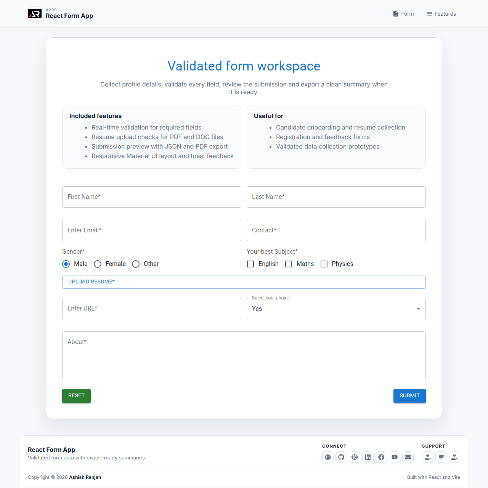

# React Form App

A responsive React and Vite form demo for validating profile details, checking a selected resume file locally, reviewing the values and exporting a summary.

## Features

- Field validation for names, email, phone number, URL and required choices
- Local PDF, DOC and DOCX file checks for files up to 2 MB; the resume is never uploaded
- Submission summary modal with JSON and PDF export
- Reset control, inline errors and toast feedback
- Responsive Material UI layout with a fixed header and icon-only footer
- Floating go-to-top control with smooth scrolling

## Tech stack

React, Vite, Material UI, styled-components, react-icons, react-toastify and jsPDF.

This is a frontend-only demo. Profile data stays in the page until you reset or leave it, and exports are downloaded only when you choose them. The selected resume file itself is never uploaded or included in exports; only its filename and metadata are included.

## Run locally

npm install
npm run dev

Build and deploy:

npm run build
npm run deploy

## Deployment

Live: https://a2rp.github.io/react-form-app/

## Links

- Portfolio: https://www.ashishranjan.net/
- GitHub: https://github.com/a2rp
- CodePen: https://codepen.io/ash1198
- LinkedIn: https://www.linkedin.com/in/aashishranjan
- Facebook: https://www.facebook.com/theash.ashish/
- YouTube: https://www.youtube.com/@ashishranjan-ashz?sub_confirmation=1
- Email: mailto:ash.ranjan09@gmail.com

## Support

- Support: https://a2rp-donation-page.netlify.app/
- Buy Me a Coffee: https://buymeacoffee.com/a2rp
- Patreon: https://patreon.com/a2rp
